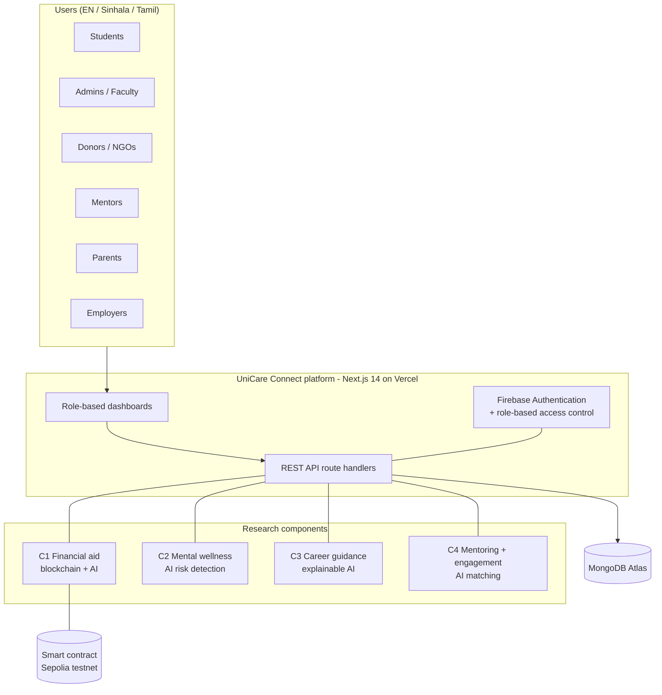
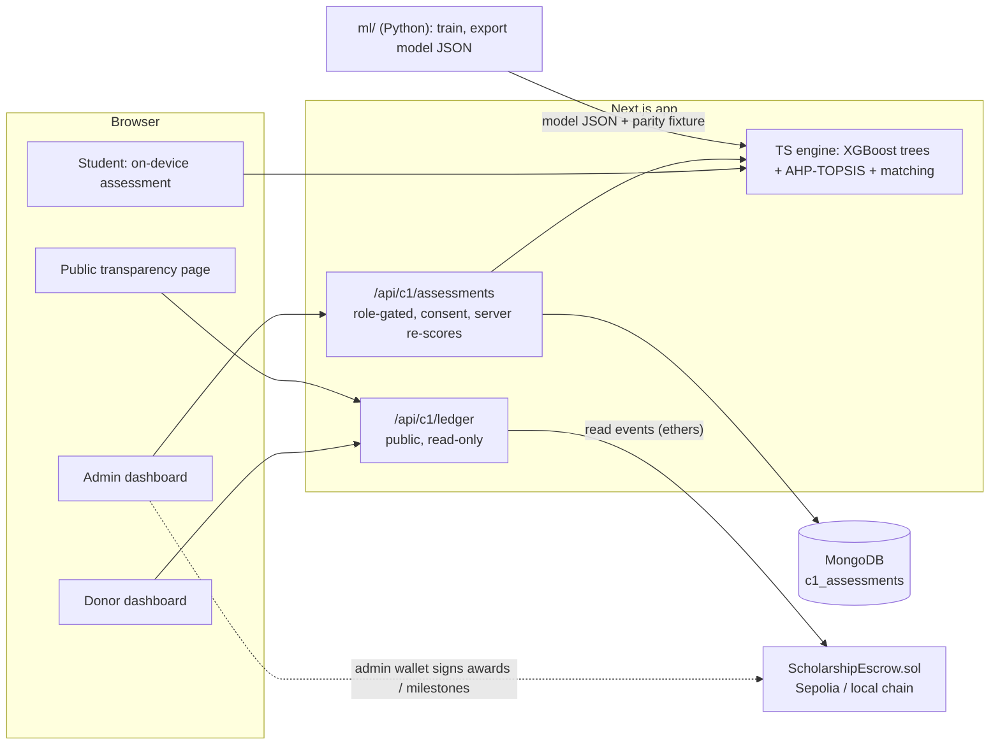
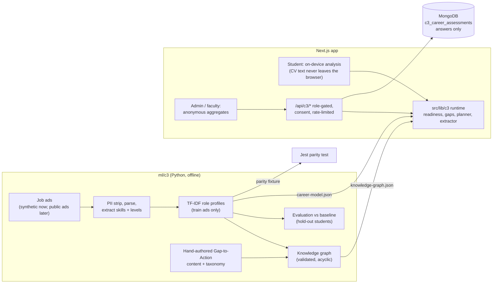
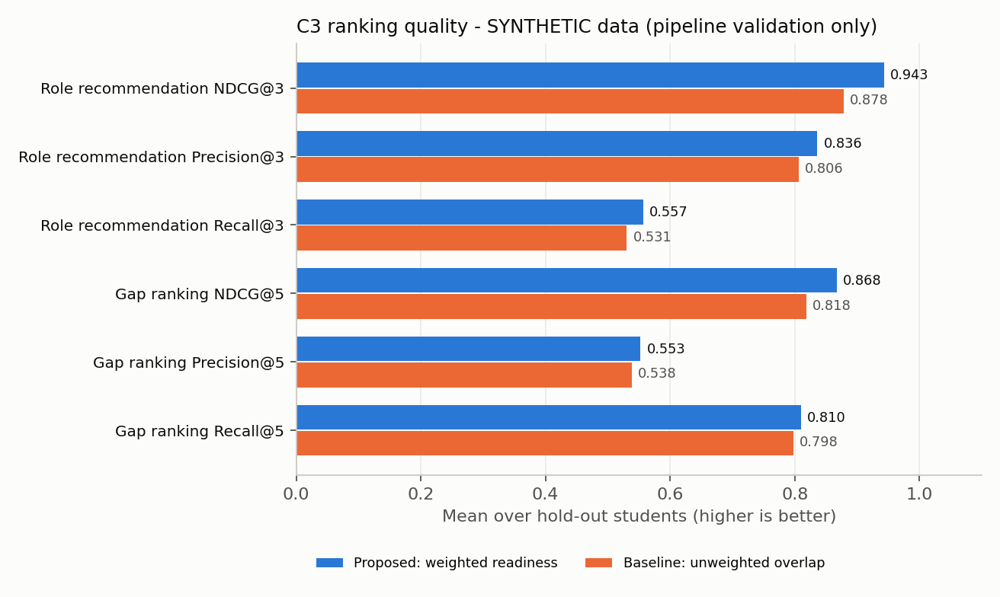
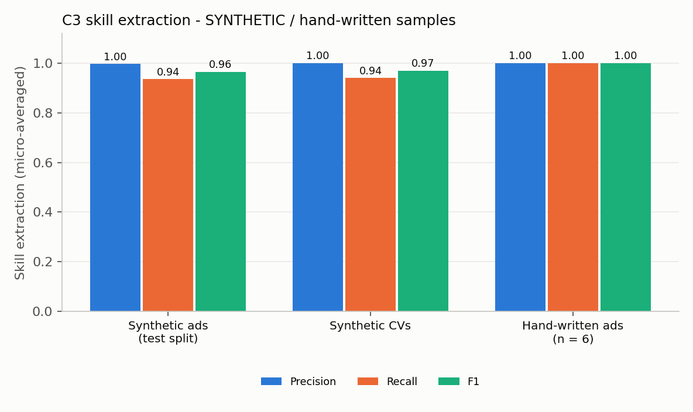
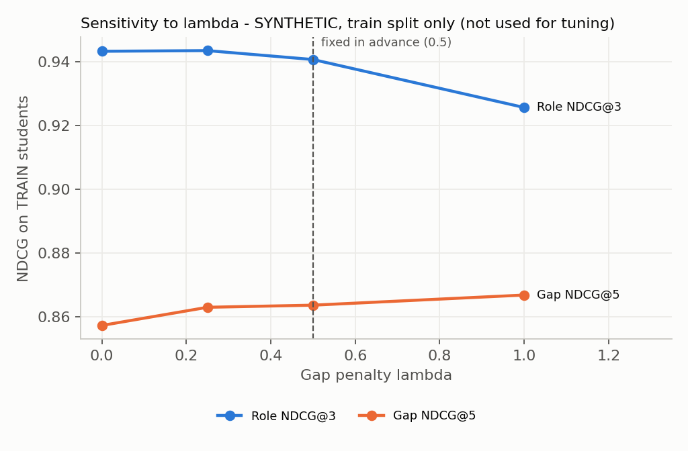

# UniCare Connect

**A multilingual, role-based student support platform for Sri Lankan universities**

IT4010 Research Project - Group **J26-IT-345** - SLIIT, Faculty of Computing, Department of Information Technology
Specialization: **IT** - Research cluster: **SST (Software Systems & Technologies)** - Industry vertical: EdTech
Supervisor: Prof. Dasuni Nawinna - Co-supervisor: Ms. Aruni Premarathne

> **Honesty note.** The anonymised SLIIT student dataset requested from the supervisors has not been received yet. Every machine-learning number in this repository comes from **clearly labelled synthetic data**: it shows that the pipelines work end to end, **not** how accurate they are on real students. Contract measurements (gas, tests, coverage, static analysis) are real. Each result below says which kind it is.

---

## Contents

1. [The research at a glance](#1-the-research-at-a-glance)
2. [Team and components](#2-team-and-components)
3. [Platform architecture](#3-platform-architecture)
4. [Repository structure](#4-repository-structure)
5. [Quick start](#5-quick-start)
6. [Component C1 - Transparent, AI-assisted financial aid](#6-component-c1---transparent-ai-assisted-financial-aid) (implemented)
7. [Components C2, C3, C4](#7-components-c2-c3-c4) (structure ready, work in progress)
8. [How to add a component to the platform](#8-how-to-add-a-component-to-the-platform)
9. [Testing and quality](#9-testing-and-quality)
10. [Ethics, privacy and AI-use disclosure](#10-ethics-privacy-and-ai-use-disclosure)
11. [Project timeline and assessment](#11-project-timeline-and-assessment)
12. [Troubleshooting](#12-troubleshooting)
13. [Documentation map](#13-documentation-map)

---

## 1. The research at a glance

**Problem.** Sri Lankan university students face fragmented access to financial aid, career guidance, mentorship and wellness support. Scholarship news travels by notice boards and WhatsApp; screening is manual and inconsistent; donors cannot verify where money went; rural students are shut out by English-only, high-bandwidth platforms; and universities have no consolidated view of student needs. The consequences are missed opportunities, stress and widening inequality (SDG 3, 4, 8, 10, 16).

**Gap.** No existing platform in Sri Lanka integrates financial aid, career, mentoring and wellness for seven stakeholder roles in one multilingual system with intelligent, *explainable* recommendation. Prior work treats each service, and each technology (blockchain transparency, AI need-assessment, recommender systems), separately.

**Main objective.** To design, develop and evaluate a centralised, multilingual, role-based student support platform (UniCare Connect) that improves student access to financial aid, mentorship, career guidance and wellness resources in Sri Lankan universities.

**Method.** Design Science Research (DSR): problem identification -> solution objectives -> design and development -> demonstration -> evaluation against baselines and metrics -> communication. Agile, iterative implementation on a shared platform.

**Scope of the pilot.** SLIIT Year 3 and Year 4 IT undergraduates, expanding to other Sri Lankan universities afterwards.

**Novelty (per component).** See the table in section 2: each member contributes an AI/analytics component with its own research question, baselines and evaluation, all integrated through one role-based platform.

## 2. Team and components

| Component | Owner | Research focus | Status in this repository |
| --- | --- | --- | --- |
| **C1** | Wijesinghe S K (IT23152700) - group leader | Blockchain-based transparent financial aid, AI financial-vulnerability assessment, AI scholarship matching, admin and donor monitoring | **Implemented** (section 6) |
| **C2** | D. G. A. Indeepa (IT23273412) | AI-powered mental wellness support and early risk detection: bounded conversational assistant, PHQ-9 / GAD-7 self-assessments, optional facial-expression analysis, mood journaling, quality-aware multimodal fusion, confidential counselor referral | First text model and fictional reflection workspace implemented; remaining research in section 7 |
| **C3** | K. K. T. C. Kamburugoda (IT23155084) | Explainable AI career guidance: NLP over Sri Lankan IT job advertisements, CV and questionnaire analysis, career-path recommendation with readiness scores, skill-gap prioritisation, Gap-to-Action knowledge graph | **Implemented on synthetic data** (section 7, C3) |
| **C4** | L. L. E. Harshana (IT23195202) | AI mentor matching and student engagement: dynamic multi-criteria mentor matching, activity recommendation, privacy-aware parent/guardian communication, peer collaboration, engagement and mentorship analytics | Mentor matching implemented on synthetic data; other C4 parts open (section 7) |

The platform itself (authentication, role dashboards, notifications, multilingual UI) started as the IT3040 IT Project Management project and is the shared base that all four components plug into.

## 3. Platform architecture



Every component follows the same pattern (see section 8): a dashboard section per role, role-gated API routes, a typed library under `src/lib/<component>`, consent-first data handling, a demo mode that works without the database, English / Sinhala / Tamil text, and tests.

## 4. Repository structure

```
UniCare Connect/
├── README.md                     <- this file (the single project README)
├── .env.example                  environment variable names (no secrets)
├── src/                          Next.js 14 web application
│   ├── app/                      pages and API routes
│   │   ├── api/c1/               C1 endpoints (ledger, assessments)
│   │   ├── api/c2|c3|c4/         reserved for C2, C3, C4 (empty)
│   │   ├── transparency/         C1 public audit ledger page
│   │   └── aid-assessment/       C1 on-device assessment page
│   ├── components/
│   │   ├── c1/                   C1 UI (ledger explorer, assessment tool)
│   │   ├── c2|c3|c4/             reserved (empty)
│   │   ├── admin/ donor/ ...     existing role dashboards
│   │   └── dashboard/student/    existing student dashboard sections
│   └── lib/
│       ├── c1/                   C1 model runtime, matching, ledger, i18n, validation
│       ├── c2|c3|c4/             reserved (empty)
│       └── ...                   auth, MongoDB, RBAC, demo stores
├── blockchain/                   C1 - Hardhat project: contracts, tests, deploy/benchmark scripts
├── ml/                           research code and data (never commit real data)
│   ├── *.py, data/               C1 - synthetic data, AHP-TOPSIS, XGBoost training
│   ├── c2/                       C2 - data/ notebooks/ models/ evaluation/ src/{text-sentiment, facial-expression, fusion}
│   ├── c3/                       C3 - data/ notebooks/ models/ evaluation/ src/{job-ad-nlp, skill-extraction, knowledge-graph, recommender}
│   └── c4/                       C4 - data/ notebooks/ models/ evaluation/ src/{mentor-matching, activity-recommendation, analytics}
├── tests/
│   ├── unit/ integration/ fixtures/     C1 tests live here; c2/ c3/ c4/ sub-folders reserved
├── scripts/                      evaluation scripts (c1 implemented; c2|c3|c4 reserved)
└── docs/
    ├── openapi.yaml              API reference
    ├── c1/ c2/ c3/ c4/           per member: proposal/ evidence/ reports/
    └── shared/                   logbook/ ethics/ checklists/ presentations/
```

Under every `ml/cN/data/` there are `raw/` and `private/` folders whose **contents are git-ignored** (only `.gitkeep` is tracked). Real or sensitive data (wellness, facial images, CVs, student records) must live there and never be committed. Empty folders are kept in Git with a `.gitkeep` file.

## 5. Quick start

Requires Node.js 20+ (tested on 22) and npm. Python 3.11+ is only needed for the AI pipelines.

```bash
npm install
cp .env.example .env.local      # NEXT_PUBLIC_DEMO_MODE=true by default (no database or Firebase needed)
npm run dev                     # http://localhost:3000
```

Public C1 pages that work without logging in: `/aid-assessment` (private, on-device need check) and `/transparency` (blockchain audit ledger; a local simulation until a testnet address is configured). Role dashboards (`/dashboard/<role>`) need Firebase sign-in and MongoDB (see section 12).

| Command | Purpose |
| --- | --- |
| `npm run dev` / `build` / `start` | Develop / production build / serve |
| `npm run lint` / `typecheck` | ESLint / `tsc --noEmit` |
| `npm test` | Jest unit, component and API tests (78 tests) |
| `npm run test:e2e` | Playwright end-to-end tests |
| `npm run c1:ml` | Regenerate C1 synthetic data and retrain the vulnerability model |
| `npm run c1:eval-matching` | C1 scholarship-matching evaluation (NDCG) |
| `npm run c1:chain:test` | C1 contract tests |

**Environment variables** (see `.env.example`): `NEXT_PUBLIC_DEMO_MODE`, `MONGODB_URI`, `MONGODB_DB_NAME`, `NEXT_PUBLIC_FIREBASE_*`, `FIREBASE_WEB_API_KEY`, and the optional C1 ledger settings `C1_RPC_URL`, `C1_ESCROW_ADDRESS`, `C1_DEPLOY_BLOCK` and `C1_STUDENT_REF_SALT`. Secrets live only in `.env.local` / `blockchain/.env` (both git-ignored).

---

## 6. Component C1 - Transparent, AI-assisted financial aid

**Research question.** Can an AI model that assesses multidimensional financial vulnerability, combined with blockchain escrow and milestone-based disbursement, make scholarship administration fairer and more transparent than manual, threshold-based screening?

**Gap.** Blockchain scholarship transparency and AI need-assessment exist separately; none combines both for Sri Lankan higher education with multilingual access.

### 6.1 What is implemented

| Capability | Where | Status |
| --- | --- | --- |
| Solidity escrow: campaigns, awards, **milestone-based automatic release**, revoke, pause, pull-payment fallback | `blockchain/contracts/ScholarshipEscrow.sol` | Done - 26 tests, 100% line / 86% branch coverage, Slither 0 high/critical |
| Gas benchmark | `blockchain`: `npm run benchmark` | Done - max **150,945 gas** per disbursement (target < 250,000) |
| AI vulnerability model: XGBoost + explainable AHP-TOPSIS, 5-fold CV, baselines, fairness check | `ml/` | Pipeline done - **synthetic data** |
| Python-to-TypeScript model parity (runs on Vercel, no Python service) | `src/lib/c1/vulnerability.ts` | Done - parity test |
| Scholarship matching (eligibility + weighted alignment), NDCG evaluation vs rule-based baseline | `src/lib/c1/matching.ts` | Done - target not yet met |
| Public **Transparency Ledger** with integrity fingerprint | `/transparency`, `/api/c1/ledger` | Done (simulation + live-chain reader) |
| Downloadable **donor audit report** (CSV for donors, JSON with a re-computable fingerprint for auditors) | `/api/c1/ledger/report`, download buttons on every ledger view, `npm run c1:audit-report` | Done - reads live Sepolia data automatically once deployed |
| **Student notifications from chain events & upcoming deadlines (FR11)**: award, milestone verified, payment released or queued, completed, revoked, withdrawn, plus reminders for eligible scholarships closing within 14 days; shown in the notification counts and a *Scholarship updates* card, in English / Sinhala / Tamil | `src/lib/c1/chain-notifications.ts`, `/api/notifications`, `src/components/c1/scholarship-updates.tsx` | Done |
| On-device **aid assessment** (nothing leaves the browser) | `/aid-assessment` | Done |
| 12 **fictional sample students** (rural single-parent, high GPA / low income, large family, comfortable household...) with a "Try a sample student" picker and a per-case evidence report | `src/lib/c1/demo-cases.ts`, `npm run c1:demo-cases` | Done - fictional, for demos |
| Dashboard sections: student *Smart Aid Matching*; admin / faculty *Aid Prioritisation* and *Fund Ledger*; donor *Fund Transparency* | `src/components/...` | Done (tested; not yet verified with live login) |
| English / Sinhala / Tamil for every C1 screen | `src/lib/c1/i18n.ts` | Done - **needs native-speaker review** |
| **AES-256-GCM encryption at rest (NFR02 / FR01)** for saved student financial profiles (`c1_assessments`) + `bytes32` assessment commitment hashes | `src/lib/c1/encryption.ts`, `src/lib/c1/assessment-store.ts` | Done |
| **Donor & Admin wallet signing UI (FR02, FR06, FR09, FR10)**: donor wallet filter, `createCampaign`, `topUpCampaign`, `verifyMilestone`, `awardScholarship` + queue-to-award commitment link | `src/lib/c1/wallet-actions.ts`, `src/components/c1/ledger-explorer.tsx`, `src/components/admin/admin-aid-prioritisation.tsx` | Done |
| Deployment to Sepolia and live latency measurement (`NFR03`, `NFR06`) | `blockchain/deployments/sepolia.json`, `docs/c1/evidence/latency-sepolia.json` | **Done - real Sepolia** (`0xFF768B0CBa1f6B9237ce31f024ACBb3D69a83ae0`, block `11952920`; mean **11.63 s**, p95 **13.47 s** < 30 s) |

### 6.2 Architecture



**Design decisions.**

| Decision | Why |
| --- | --- |
| No personal data on-chain | Students are `keccak256(id, secret salt)`; assessments are hash commitments (NFR02/NFR04). Erasure = destroy the off-chain salt. |
| Run the model in TypeScript | No separate Python service (cost, latency, attack surface); the 160-tree, 50 KB model scores in under a millisecond; a parity test keeps it identical to Python. |
| XGBoost **and** AHP-TOPSIS | Accuracy plus reasons a welfare officer can read and contest (consistency ratio 0.008). The pairwise judgements are provisional and must be validated with welfare officers. |
| On-device assessment | The public tool computes in the browser; saving to the welfare office needs explicit consent and can be deleted. |
| Events as the audit ledger | Cheaper than logs; the app recomputes every number from events so anyone can re-derive it. |
| Pull-payment fallback | A wallet that rejects payment must not freeze an officer's workflow. |

**Contract at a glance.**

| Function | Role | Effect |
| --- | --- | --- |
| `createCampaign(metadataHash)` payable | DONOR | Opens a funded campaign |
| `topUpCampaign(id)` / `closeCampaign(id)` | campaign donor | Adds funds / refunds unallocated funds |
| `awardScholarship(campaignId, beneficiary, studentRef, assessmentHash, amount, milestones)` | ADMIN | Reserves funds for a student (1-12 equal tranches) |
| `verifyMilestone(awardId, evidenceHash)` | ADMIN | Verifies the next milestone **and** releases its tranche |
| `revokeAward(awardId, reasonHash)` | ADMIN | Returns the unreleased balance |
| `withdrawPending()` | anyone owed funds | Pull payment if a push transfer failed |
| `pause()` / `unpause()` | DEFAULT_ADMIN | Emergency stop |

Safety: OpenZeppelin `AccessControl`, `ReentrancyGuard`, `Pausable`; checks-effects-interactions; accounting identity `funded = disbursed + committed + available` tested as an invariant. Known limits: the welfare officer is a *trusted verifier* of milestone evidence (the chain proves who verified what, not that the evidence was true); test ETH has no monetary value; testnet only, not production-audited.

### 6.3 Results

| Metric (proposal Table 4) | Target | Result | Status |
| --- | --- | --- | --- |
| Gas per disbursement | < 250,000 | **150,945** worst case (first payment to a brand-new wallet; 74,645 typical) | Met - real |
| Slither critical / high findings | 0 | **0** (1 medium - intentional rounding, 1 low - benign, 3 informational) | Met - real |
| Contract tests / coverage | - | 26 tests; 100% statements / lines / functions, 86% branches | Real |
| AI inference time | < 1.5 s | < 1 ms per student | Met - real |
| Precision / Recall / F1 | >= 0.85 | 0.874 / 0.952 / 0.912 hold-out; F1 0.884 +/- 0.021 5-fold CV | **Synthetic** - pipeline validated only |
| Matching NDCG@5 vs rule baseline | >= 0.88 | **0.816** vs 0.588 baseline (+0.23, 95% CI 0.19-0.26) | **Not met** - synthetic |
| Transaction latency | < 30 s | **11.63 s** mean / **12.10 s** median / **13.47 s** p95 (n = 14 on Sepolia) | **Met - real** (`docs/c1/evidence/latency-sepolia.json`) |
| SUS usability | >= 75 | not measured | Open - needs user study |


| Model (5-fold CV, synthetic) | Precision | Recall | F1 |
| --- | --- | --- | --- |
| Baseline 1: income cut-off (< LKR 60,000) | 0.514 | 0.975 | 0.673 |
| Baseline 2: AHP-TOPSIS (top 28%) | 0.864 | 0.860 | 0.861 |
| Logistic regression | 0.919 | 0.890 | **0.904** |
| Random forest | 0.916 | 0.844 | 0.877 |
| **XGBoost** (deployed) | 0.899 | 0.872 | 0.884 |

<details>
<summary><b>How to read these results (important)</b></summary>

- **Synthetic data.** 3,000 generated students with a hidden expert-style rubric plus noise stand in for the SLIIT dataset. Label and features come from the same generator, so the metrics cannot show real-world accuracy.
- **Logistic regression is at least as good as XGBoost here** because the synthetic rubric is mostly additive. XGBoost was not tuned to "win"; real data will decide whether the extra complexity is justified.
- The single income cut-off flags nearly everyone who is poor (recall 0.97) but over-flags (precision 0.51), consistent with the proposal's argument against binary screening.
- **Matching NDCG target not met.** Relevance judgements are simulated by a rubric whose intuitions overlap with the ranker, so even the size of the gain is optimistic. Weights were deliberately **not** tuned to cross 0.88 on this set (that would be overfitting a made-up rubric). Plan: real welfare-officer judgements + learning-to-rank.
- **Equity check (hold-out recall).** Rural 0.946, urban 0.961, single-parent 0.911 (n = 75), two-parent 0.967. A small gap to re-test on real data.
- Protocol: stratified 80/20 split shared with the matching evaluation (no leakage); 5-fold CV on the training split only; decision threshold (0.346) chosen on out-of-fold predictions; hold-out used once.

| Hold-out ROC | Hold-out confusion matrix (TN 409, FP 23, FN 8, TP 160) |
| --- | --- |
|  |  |

Raw evidence: `docs/c1/evidence/` (`gas-report.json`, `latency-sepolia.json`, `latency-hardhat.json`, `vulnerability-eval.json`, `matching-eval.json`, `slither-report.json`, `demo-cases.json`, `audit-report.csv`, `audit-report.json`).

**Sample students (fictional).** Of the 12 hand-written cases, the model rates 6 high, 2 moderate and 4 low need, and ranks every clearly needy case above the comfortable households. It disagrees with the explainable AHP-TOPSIS score on one case, S09 (formal job, rural, boarding: index 3, TOPSIS 0.56) - the kind of borderline case a welfare officer should review. Scores cluster near 0 and 100, a sign of the synthetic training rubric; real data should give more graded scores.
</details>

### 6.4 Requirements status

Functional (FR) - 12 done, 0 partial, 0 open (100% implemented in code and deployed live to Ethereum Sepolia):

| ID | Requirement (short) | Status | Remaining external validation |
| --- | --- | --- | --- |
| FR01 | Student profile with socio-economic indicators (AES-256-GCM at rest) | Done | - |
| FR02 | Donors create campaigns, deposit into escrow | Done (verified on Sepolia) | - |
| FR03 | Capture and preprocess indicators | Done | - |
| FR04 | AI Vulnerability Index 0-100 | Done (synthetic) | Retrain on SLIIT data |
| FR05 | Rank and recommend scholarships | Done | NDCG target on welfare-officer judgements |
| FR06 | Admins verify milestones | Done (verified on Sepolia) | - |
| FR07 | Automated disbursement on verified milestone | Done (verified on Sepolia) | - |
| FR08 | Ledger of tx hashes + audit reports for donors | Done (live on Sepolia) | - |
| FR09 | Admin dashboard: fund flows, approvals, reports, queue-to-award commitment link | Done | - |
| FR10 | Donor dashboard with donor wallet filter | Done | - |
| FR11 | Notifications on status, disbursement and upcoming deadlines (<= 14 days) | Done | - |
| FR12 | Sinhala / Tamil / English | Done | Native-speaker review |

Non-functional (NFR): met - NFR01 (0 critical), NFR02 (zero PII on-chain; AES-256-GCM off-chain encryption at rest), NFR03 (100% transaction traceability on Sepolia), NFR04 (hashes only; `keccak256` used instead of SHA-256), NFR05, NFR06 (Sepolia latency mean 11.63 s, p95 13.47 s < 30 s), NFR07, NFR09; partial - NFR12 (accessible forms, no formal WCAG audit); open - NFR08 (SUS), NFR10 (1,000 users), NFR11 (99.9% uptime).

### 6.5 Interfaces

**API** (full reference in `docs/openapi.yaml`)

| Endpoint | Access | Purpose |
| --- | --- | --- |
| `GET /api/c1/ledger?limit=` | Public, read-only, pseudonymous | Totals, campaigns, awards, recent events, SHA-256 integrity digest |
| `GET /api/c1/ledger/report?format=csv\|json` | Public, read-only, pseudonymous | Downloadable audit report (FR08): every event with its transaction hash, totals and the same digest |
| `GET /api/c1/assessments` | Student | Own saved assessment + ranked scholarships |
| `GET /api/c1/assessments?scope=catalogue` | Student | Rankable scholarships for on-device matching |
| `GET /api/c1/assessments?scope=queue` | Admin, faculty | Students ranked by need (derived fields only) |
| `POST /api/c1/assessments` | Student | Save an assessment; **explicit consent required**; the server re-scores and ignores any client-supplied index |
| `DELETE /api/c1/assessments` | Student | Erase the stored assessment (withdraw consent) |

Donor scholarships (`POST /api/donor/scholarships`) accept an optional structured `criteria` object (`type`, `minGpa`, `maxMonthlyIncomeLkr`, `minVulnerability`, `eligibleYears`, `ruralOnly`) so real scholarships can be ranked.

**Data model - collection `c1_assessments`** (one document per consenting student): `userId` / `firebaseUid`, `studentName`, `university`, `profile` (the financial answers; visible to the student only), `assessment` (`vulnerabilityIndex`, `probability`, `band`, `flaggedVulnerable`, `topsisScore`, `topFactors[]`, `modelVersion`, `syntheticTraining`), `consentAt`, `updatedAt`. Officers read only derived fields. The blockchain ledger is **not** stored in MongoDB: it is read from contract events (or the bundled simulation) and recomputed on each request.

### 6.6 How to run the C1 parts

```bash
# Smart contracts
cd blockchain && npm install
npm test                  # 26 tests
npm run test:gas          # per-function gas
npm run coverage          # statement / branch coverage
npm run benchmark         # -> docs/c1/evidence/gas-report.json
npm run simulate          # -> src/lib/c1/demo-ledger.json (real EVM run, dated Sep-Oct 2026)
npm run abi               # -> src/lib/c1/abi/ScholarshipEscrow.json
npm run node              # local chain;  then in another terminal: npm run seed:local
npm run slither           # static analysis (pip install slither-analyzer)

# AI pipeline (from the repo root)
pip install -r ml/requirements.txt
cd ml && python synthetic_data.py && python train_vulnerability.py
cd .. && npm run c1:eval-matching
npm run c1:demo-cases    # 12 fictional sample students -> docs/c1/evidence/demo-cases.json
npm run c1:audit-report  # donor audit report -> docs/c1/evidence/audit-report.csv / .json
```

`ml/` files: `synthetic_data.py` (synthetic students + 24 illustrative scholarships + simulated relevance), `features.py` (feature engineering, mirrored in TypeScript), `ahp_topsis.py` (weights + closeness score), `train_vulnerability.py` (LR / RF / XGBoost, CV, hold-out, fairness, export of the web-app model and parity fixture).

**Using real data later:** put the anonymised dataset in `ml/data/raw/` (git-ignored) with the columns listed in `synthetic_data.RAW_COLUMNS` plus an expert-validated `vulnerable` label; point `train_vulnerability.py` at it (keep the shared `split_indices`); re-run; check subgroup metrics; and remove the synthetic warnings only when the model is truly trained on approved real data.

### 6.7 Deploying to the Sepolia testnet (closes NFR03 and NFR06)

> Use a brand-new throw-away wallet that has never held real funds. Never paste its private key into chat, a commit or a document. `blockchain/.env` is git-ignored.

1. Create a new wallet account; get free Sepolia ETH from a public faucet (~0.05 ETH is plenty); create a free Alchemy or Infura Sepolia RPC URL.
2. `cd blockchain && cp .env.example .env`, then set `SEPOLIA_RPC_URL` and `DEPLOYER_PRIVATE_KEY`. Run `npm test`.
3. `npm run deploy:sepolia` - prints the contract address and deploy block, saves `deployments/sepolia.json`, refreshes the ABI.
4. Grant roles to other wallets (optional): `ADMIN_ADDRESSES=0x...,0x... DONOR_ADDRESSES=0x... npm run roles:sepolia`.
5. `npm run latency:sepolia` - runs the real workflow (campaign, 12-milestone award, 12 verifications), times each transaction from submit to one confirmation, writes `docs/c1/evidence/latency-sepolia.json`. Target: p95 < 30 s. Report whatever you measure, including a miss.
6. In `.env.local` (and **Vercel -> Settings -> Environment Variables**) set `C1_RPC_URL`, `C1_ESCROW_ADDRESS`, `C1_DEPLOY_BLOCK`. `/transparency` then shows **Live blockchain** with Etherscan links. The web app only *reads* the chain; never put `DEPLOYER_PRIVATE_KEY` into Vercel.
7. For student notifications (FR11), also set a secret `C1_STUDENT_REF_SALT` and award with `studentRef = keccak256("<platform user id>:<salt>")`, so the app can recognise each student's own awards. Never change the salt once awards exist.

Local rehearsal without a testnet: `npm run node` + `npm run seed:local` in `blockchain/`, then set `C1_RPC_URL=http://127.0.0.1:8545` with the printed address.

### 6.8 Top risks and roadmap

| Risk | Mitigation / action |
| --- | --- |
| SLIIT dataset not released in time | Pipeline built on labelled synthetic data; chase supervisors; fallback = public dataset + own consented questionnaire |
| Synthetic results mistaken for real findings | Warnings in README, UI, API responses and model JSON; report only real-data results in the thesis |
| Ethics clearance delays data collection | Submit the SLIIT ethics application now; no real student data until approved |
| Matching target not reached | Real welfare-officer judgements; learning-to-rank |
| **Citation integrity** - a spot check found proposal references with wrong authors or that could not be located ([7] is a real IEEE Access 2024 paper credited to the wrong authors; [5] could not be found; [21]-[25] are non-specific) | Verify **every** reference against the publisher before the final report and paper |
| Model bias | Report subgroup metrics on real data; keep the explainable second opinion; model supports, never replaces, officer judgement |

**Roadmap.** (1) Receive the SLIIT dataset; retrain and re-evaluate. (2) Welfare-officer judgements for AHP weights and matching relevance. (3) Deploy to Sepolia; measure latency; add admin-wallet signing in the dashboard. (4) Usability study (SUS >= 75, n >= 30) and native-speaker review of Sinhala/Tamil. (5) Notifications from chain events (FR11), downloadable audit report (FR08). (6) Integrate with C2-C4; final report and research paper.

---

## 7. Components C2, C3, C4

Each component keeps its implementation, experiments and evidence in its own folders. Current status and remaining work are described below; scope is taken from each member's proposal report.

### C2 - AI-powered mental wellness support and early risk detection (D. G. A. Indeepa)

**Follow-through update, 20 October 2026.** **My plan** now connects confirmed check-in topics and follow-up answers to three replaceable suggestions and seven guided activities. **Progress** optionally stores selected mood ratings, screening summaries and activity completions on this browser, with an explicit shared-device acknowledgement and deletion controls. Activity writing, reflections and chat remain in temporary session memory. **Prepare my appointment** offers a student-selected preview and plain-text download; nothing is automatically sent to a professional. See [the implemented workflow and PP1 walkthrough](docs/c2/PP1_NEXT_STEPS_INCREMENT.md). The added activities await professional review and do not change the model or standard questionnaire scores.

**Main model update, 20 October 2026.** The expanded DistilBERT concern model has 15 non-diagnostic support outputs. Model-assisted routing asks 5–9 questions from a 270-question MongoDB bank using confirmed topics and previous answers. Self-harm support uses a separate direct-disclosure route, independent of ML scores. See [the current PP1 model explanation](docs/c2/PP1_EXPANDED_TOPICS.md). Trained weights remain outside normal Git and are transferred using the private offline ZIP; a public model Release has not been approved or published. Follow [C2 model setup](docs/c2/RUN_ON_ANOTHER_LAPTOP.md) to install the matching trained export without retraining. The earlier reflection experiment below remains separately available.

**Implemented, 19 October 2026.** A fresh wellness workspace is available at `/wellness` and in the student dashboard's Wellness section. It includes complete PHQ-9/GAD-7 scoring, relevant follow-ups from a fixed question bank, an understandable screening summary, optional reflection/text analysis, local guided support chat and professional preferences (gender, language, type and mode). Forum topics filter actual discussions. Check-in, reflection and chat data remain local to the page session. Booking requests and forum posts are separate, explicit actions; assessment answers are never attached automatically. No fictional-student prompt is shown in the user interface.

The reproducible text experiment uses public GoEmotions data, TF-IDF and regularized one-vs-rest logistic regression. It trains on 42,854 deduplicated comments, selects settings on 5,308 development rows and evaluates once on 5,313 retained test rows: micro-F1 **0.5552**, macro-F1 **0.4084**, compared with frequency-baseline micro-F1 **0.3054**. These measure public-comment emotion labels, **not mental health or referral accuracy**. Browser inference is checked against Python scores. The model has no local student training data, clinical validation, automatic referral or camera capture.

See [training instructions](ml/c2/README.md), [model card and limitations](docs/c2/model-card.md), [evaluation evidence](docs/c2/evidence/text-evaluation.json) and [assessment implementation verification](docs/c2/reports/assessment-increment.md). Professional review of additional content, synthetic fusion experiments, optional facial features, confidential assigned-counselor access and the approved local study remain pending. The chat uses a limited response library; no generative provider is connected. AI assistance is disclosed in the model card; student review and contribution records are required.

**Scope.** A bounded conversational assistant; PHQ-9 and GAD-7 self-assessments; optional facial-expression analysis; mood journaling; confidential counselor referral. **Research contribution:** an empirical assessment of quality-aware multimodal fusion (missing-camera conditions, uncertainty, and the incremental value of facial cues beyond questionnaires and text). Outputs support referral decisions - they do not diagnose or predict suicide. Evaluation: ethics-approved feasibility pilot (about 30 adult undergraduates) with counselor-reviewed cases, comparing questionnaire-only, text-only and fused variants.

| Folder | Intended use |
| --- | --- |
| `ml/c2/src/text-sentiment/` | Text / journal affect models |
| `ml/c2/src/facial-expression/` | Optional facial-expression recognition |
| `ml/c2/src/fusion/` | Quality-aware multimodal fusion and uncertainty |
| `ml/c2/{data,notebooks,models,evaluation}/` | Datasets (public affect corpora in `synthetic/` or `processed/`; **never commit `raw/` or `private/`**), experiments, trained models, metrics |
| `src/lib/c2/`, `src/components/c2/`, `src/app/api/c2/` | Web integration (assistant UI, assessments, referral flow) |
| `tests/{unit,integration,fixtures}/c2/`, `scripts/c2/` | Tests and evaluation scripts |
| `docs/c2/{proposal,evidence,reports}/` | Proposal, evidence, reports |

### C3 - Explainable AI career guidance (K. K. T. C. Kamburugoda)

> **Status: implemented end to end; role profiles are still built from SYNTHETIC data** (branch `research/c3-career`, October 2026). The SLIIT ethics application is submitted but not approved, so no real student data is used. 255 manually collected public job advertisements are used only for a preliminary evaluation (skill extraction, role from title, job titles) and are labelled **"Real ads, preliminary"**. Every other ML number says **"SYNTHETIC DATA: validates the pipeline, not real-world accuracy"**. Timings and test counts are real.

**Scope.** NLP over Sri Lankan IT job advertisements to build evidence-based role requirements; a questionnaire (and optional CV text) for Year 3/4 IT students; a transparent readiness score per career path; ranked skill gaps; a reason for every number; and a **Gap-to-Action knowledge graph** that turns gaps into an ordered plan of modules, projects, certifications and free resources. Baseline: transparent unweighted content-based matching.

#### C3.1 What is implemented

| Capability | Where | Status |
| --- | --- | --- |
| Job-ad schema, collector (allow-listed domains, robots.txt, >= 5 s delay, output only to git-ignored `raw/`), cleaner (PII strip, dedupe, validate) | `ml/c3/src/job-ad-nlp/` | Done - collector **not yet run on any real site** |
| Ad parser: role from title, level from cue phrases ("strong knowledge of" -> 3), "nice to have", experience, education, certifications | `ad_parser.py` | Done |
| Competency taxonomy v1.1.0: 26 competencies, 7 areas, levels 0-3, synonyms (v1.1.0 adds phrases real Sri Lankan ads use, chosen on the 98-ad development set), EN/SI/TA labels, JSON Schema | `ml/c3/data/reference/competency-taxonomy*.json` | Done - needs academic / industry validation |
| PII stripping (e-mail, URL, NIC old/new, SL phone, labelled lines, street addresses) before any processing | `pii.py`, `src/lib/c3/extract.ts` | Done |
| Dictionary + fuzzy skill extractor (longest match first, rapidfuzz ratio >= 90 for terms >= 7 chars) for ads and CVs | `skill_extractor.py`, `extract.ts` | Done |
| Synthetic data: 600 ads (+ 6 hand-written, labelled), 3,000 students with simulated expert labels, 200 CVs (seed 42) | `ml/c3/data/synthetic/` | Done - **synthetic** |
| Role profiles: TF-IDF skill weights + median required level from training ads | `role_profiles.py` | Done |
| Baseline (unweighted overlap) and proposed weighted readiness with per-skill contributions; gap ranking by readiness gain | `readiness.py`, `src/lib/c3/{readiness,gaps}.ts` | Done |
| Gap-to-Action knowledge graph (Skill, Role, Module, Project, Certification, Resource; requires, prerequisite_of, teaches, evidences) + planner with "why this" reasons | `kg.py`, `src/lib/c3/graph.ts`, `src/lib/c3/model/knowledge-graph.json` | Done - modules are **illustrative**, effort hours are estimates |
| Python-to-TypeScript parity (readiness, gaps, plans, extraction, fuzzy ratio) | `tests/unit/c3/c3-parity.test.ts` | Done - 293 checks, mutation-checked |
| API: `/api/c3/roles`, `/api/c3/assessment`, `/api/c3/plan` (role-gated, consent, Zod `.strict()`, rate-limited, erase path) | `src/app/api/c3/` | Done |
| Student section *Career Readiness*: a 4-step wizard (goals and academic background → optional CV → skills as 0-3 buttons → results), on-device analysis, explanations, plan, consent-based save / delete under the results | `src/components/c3/career-guidance-*.tsx` | Done - checked in the browser (desktop, mobile, dark mode) |
| **Academic background as context (Objective 1):** optional specialisation (IT, SE, DS, CSNE, CS, ISE, IM, Other), internship status and number of projects. Used only to order the role picker (the specialisation's common roles first, with a badge - all 12 stay and none is pre-selected), to show the year as context and to give up to 3 tips next to the plan and in the assistant's "what next" answer. **Never used in readiness, gaps or plans** (a test checks the assessment is identical with and without it) | `src/lib/c3/validation.ts`, `src/lib/c3/specialisation-roles.ts`, `career-guidance-tool.tsx`, `assistant.ts` | Done - the specialisation-to-role map is the researcher's assumption and needs confirming with SLIIT staff; interests and soft skills beyond communication are still open |
| Admin / faculty section *Career Readiness Insights* (anonymous aggregates, groups < 5 hidden; stat tiles and dependency-free charts - readiness by role, band split, common gaps, skill coverage - in a colour-blind-checked palette, with hover tooltips and the tables kept) plus a *Model and data status* card: model and taxonomy version, whether role profiles are still synthetic, real job-ad collection progress per role against the target, and the real-ads extraction check (aggregate numbers only, from `src/lib/c3/model/data-status.json`, written by `run_pipeline.py real`) | `src/components/c3/career-insights-admin.tsx`, `career-data-status.tsx`, `src/lib/c3/data-status.ts` | Done - tested; not viewable in demo mode (see C3.8) |
| English / Sinhala / Tamil | `src/lib/c3/i18n.ts` + taxonomy labels | Done - **needs native-speaker review** |
| Evaluation: P@K, R@K, NDCG@K, paired bootstrap, 5-fold CV over ads, lambda sensitivity, extraction, plan statistics, latency | `ml/c3/evaluation/`, `scripts/c3/benchmark.ts`, `docs/c3/evidence/` | Done - **synthetic** |
| **Mock interview** (FR13): 77-question bank (57 technical on all 26 skills, 8 behavioural STAR, 12 role scenarios), questions chosen from the student's top readiness gaps, rule-based rubric feedback (key points 40%, structure 20%, depth 15%, evidence 15%, clarity 10%) with reasons; feedback leads with "what went well" and "to improve next time" (detailed scores collapsed); session summary lists every answer's score, marks the strongest and weakest, and shows the next plan step for each skill to practise | `src/lib/c3/interview*.ts`, `src/components/c3/mock-interview.tsx` (tab in *Career Readiness*) | Done - on-device, nothing stored; questions need lecturer review; rubric not yet validated against human ratings |
| **AI Career Assistant** (FR12): rule-based, grounded Q&A over the student's own C3 results - 13 intents (readiness, score reasons, best-fit roles, gaps, next steps, role comparison, role requirements, learning resources, certifications, interview feedback, jobs that fit, how it works, help), matched by cue words with fuzzy typo tolerance plus the roles and skills named; every number comes from the readiness, gaps, Gap-to-Action plan, role profiles, knowledge graph or mock-interview summary, and each answer names its sources; suggested follow-up questions; "Open this section" under answers about readiness, gaps, the plan or jobs (jobs open the matched Career job board); unknown questions get the 3 closest suggested questions; EN / SI / TA answers | `src/lib/c3/assistant*.ts`, `src/components/c3/career-assistant.tsx` (tab in *Career Readiness*) | Done - on-device, no language model, nothing sent or stored; typed questions work best in English (a few Sinhala / Tamil keywords are recognised) |
| LLM mode for the assistant, LLM interview feedback | - | **Not done** - optional; would need an API key, budget and ethics approval |
| **Real job ads (manual sheet):** importer for the C3 job-ads Google Sheet export (validation: IDs, duplicate ads by URL / title + company / text, URLs, dropdown values, dates; manual role, seniority and skill labels mapped to the taxonomy; same PII stripping and parser as all ads) and a preliminary evaluation of extraction, role-from-title and seniority against the researcher's labels | `ml/c3/src/job-ad-nlp/import_sheet.py`, `ml/c3/evaluation/evaluate_real_ads.py`, `run_pipeline.py real` | Done - 255 public ads so far (target 25 per role: 6 of 12 roles reached it; Data Scientist and Cybersecurity have 14 each); one annotator; sheet and ad text stay git-ignored |
| **"Search job sites for" job titles:** each of the 12 roles is a family that real ads publish under many titles (Associate Software Engineer, Java Developer, Full Stack Developer...). For the selected role the results show the titles real ads use, with counts (e.g. QA Engineer: Quality Assurance 8, QA Engineer 7, Quality Assurance Engineer 5), so students know what to search for. Titles are cleaned (seniority words, brackets, company names removed) and counted per manual role | `ml/c3/src/job-ad-nlp/job_titles.py` (run by `run_pipeline.py real`), `src/lib/c3/model/job-titles.json`, `src/lib/c3/job-titles.ts`, `career-guidance-tool.tsx` | Done - display aid only, never a model input; title counts only (no company names, URLs or Job IDs) |
| **"Check me against a job ad":** the student pastes the text of one ad they found; the same extractor used for CVs (PII stripped first) finds the taxonomy skills it mentions and splits them into "you already have" (Basic or above, with your level) and "still to learn" (each with the least-effort first step from the Gap-to-Action graph). The ad is also matched to its closest role families (cosine similarity between the ad's skills and each role profile, up to 3, clickable), so a title the student has never seen still maps to a role | `src/lib/c3/ad-check.ts`, `career-guidance-tool.tsx` (`AdCheckCard`), `tests/unit/c3/c3-ad-check.test.tsx` | Done - display aid only, never changes scores, gaps or plans; the ad text stays in the browser and is not saved or sent; only skills in the taxonomy are counted; role matching uses the current (synthetic) role profiles |
| **"Jobs that fit you":** after the student presses "Show jobs that fit me", the platform's employer job board (GET /api/jobs) is fetched once and ranked for the selected role with the same check as "Check me against a job ad": open jobs only, at least 2 taxonomy skills, and the job must fit the selected role (the role is the job's closest role or within 0.1 of it, and similarity >= 0.35; a high match % alone is not enough), sorted by closeness to the role, then match %. Every job shows "Closest role: ...". If none fits, "No open jobs for <role> right now" is shown with up to 3 jobs for the student's other suggested roles. The card shows the top 3; each job shows match %, missing skills and the first step to close a gap, in the same card style as the Career job board. Only when no real job fits any of these roles, 8 clearly labelled fictional sample jobs are shown in a separate "Sample jobs (demo)" list | `src/lib/c3/job-recommend.ts`, `src/lib/c3/demo-it-jobs.ts`, `career-guidance-tool.tsx` (`JobsForYouCard`), `tests/unit/c3/c3-job-recommend.test.tsx` | Done - display aid only, never changes scores, gaps or plans; nothing is requested before the button, the student's levels never leave the browser; the platform's built-in demo jobs count as samples; in demo mode they are past their deadline, so only sample jobs show |
| **C3 result on the Career job board** (approved by the team leader): "See jobs that match you in Career" saves {role, skill levels, model version, time} in this browser tab's sessionStorage and opens `/dashboard/student#career`. The job board then shows a banner with Clear, a "Best match" sort (default), and on each job card the match %, up to 3 missing skills and the first step. Real jobs (platform + Remotive feed) come first; platform demo jobs are badged "Sample job (demo)"; C3 sample jobs appear only when no real job matches, under their own heading. Without a C3 result the board is unchanged | `src/lib/c3/job-match-context.ts`, `src/components/c3/use-job-match.tsx`, `src/components/c3/c3-job-card.tsx`, `annotateJob` / `bestMatchOrder` in `src/lib/c3/job-recommend.ts`, `tests/unit/c3/c3-job-match.test.tsx`; shared file `src/components/career/part-time-job-board-full.tsx` (+12 / -3 lines, slots only) | Done - skill levels never go to a server or the URL; the context expires after 24 h, is ignored for another model version and is cleared by Clear or "Erase saved data"; no job is removed from the board; Remotive jobs carry only a title, so most get no match badge |
| Role profiles from real ads, real students, SUS study | - | **Not done** - needs more ads per role / ethics approval |

#### C3.2 Architecture and model



**Readiness (proposed).** For each skill the role's ads ask for, with importance `w` (TF-IDF, sums to 1 per role), required level `Q` and the student's level `L`: attainment `a = min(L/Q, 1)`, shortfall `g = max(Q-L, 0)/Q`, points `= 100·w·(a - λ·g²)`, readiness `= clamp(Σ points, 0, 100)`. The per-skill points **are** the explanation (they add up to the score); the squared shortfall makes a missing important skill cost more than several partial ones. `λ = 0.5` was fixed in advance, not tuned. A skill found in CV text counts as level 1 and never lowers a questionnaire answer. **Gaps** are ranked by the points gained by reaching `Q`. **Baseline:** share of the role's skills the student has at any level, gaps by level shortfall.

**Gap-to-Action planner.** For the top 5 gaps: plan unmet prerequisites first (`prerequisite_of`), then repeatedly pick the action with the best readiness gain per effort hour (ties: less effort, then id); a project or certification needs the student to be at most one level below what it demonstrates. Each step carries structured reasons (gap vs ad requirement, share of ads, points gained, efficiency vs alternatives, prerequisite, proof) rendered in three languages.

| Design decision | Why |
| --- | --- |
| Rules + TF-IDF, not a black-box model | Every weight traces to ad counts that the UI shows; the student sees why. A learned ranker can be compared later on real judgements |
| Run in TypeScript, on the device | No Python service; ~0.06 ms per assessment; CV text never needs to leave the browser. A parity test keeps it identical to Python |
| Python is the source of truth | Profiles, graph and fixture are generated by one seeded script; the runtime only reads JSON |
| Answers-only storage, k = 5 aggregates | Staff need cohort trends, not individuals (data minimisation) |

#### C3.3 Results (SYNTHETIC DATA: validates the pipeline, not real-world accuracy)

Hold-out = 600 synthetic students never used for anything else; relevance = simulated expert grades 0-3 (relevant = grade >= 2); 95% CI from a paired bootstrap (2,000 resamples).

| Metric | Target | Proposed | Baseline | Difference [95% CI] | Status |
| --- | --- | --- | --- | --- | --- |
| Role recommendation NDCG@3 | not stated in repo | **0.943** | 0.878 | +0.065 [+0.053, +0.076] | Synthetic |
| Role recommendation P@3 / R@3 | not stated | 0.836 / 0.557 | 0.806 / 0.531 | +0.029 / +0.026 (CIs exclude 0) | Synthetic |
| Gap ranking NDCG@5 | not stated | **0.868** | 0.818 | +0.049 [+0.041, +0.058] | Synthetic |
| Gap ranking P@5 / R@5 | not stated | 0.553 / 0.810 | 0.538 / 0.798 | +0.014 / +0.012 (CIs exclude 0) | Synthetic |
| 5-fold CV over ads, role NDCG@3 | - | 0.941 ± 0.004 | 0.871 ± 0.008 | stable across ad samples | Synthetic |
| 5-fold CV over ads, gap NDCG@5 | - | 0.861 ± 0.028 | 0.801 ± 0.029 | | Synthetic |
| Skill extraction F1: synthetic ads / CVs / 6 hand-written ads | not stated | 0.965 / 0.969 / 1.000 | - | precision 0.996-1.00 (see below) | Synthetic / tiny sample |
| Inference time, full assessment (12 roles + 2 plans) | - | 0.06 ms mean, 0.10 ms p95 | - | - | **Real** (this laptop) |
| CV extraction, 852 words | - | 16 ms mean | - | - | **Real** |
| Skill extraction on **255 real public ads** vs the researcher's labels | not stated | P 0.906 / R 0.747 / **F1 0.819** [95% CI 0.802, 0.834] | - | synthetic F1 0.965 | **Real ads, preliminary** (1 annotator) |
| ↳ development set: the first 98 ads (used to choose the v1.1.0 synonyms) | - | P 0.902 / R 0.802 / F1 0.849 [0.826, 0.872] (taxonomy v1.0.0: F1 0.786, measured before JOB066 and JOB091 were found to be duplicates and replaced with new ads on 18 Oct) | - | - | Real ads, optimistic |
| ↳ **held-out: the 157 ads added later** (JOB099 onward, not seen when tuning; reported automatically by `run_pipeline.py real` from `DEV_LAST_JOB_NUMBER = 98` and shown on the admin status card) | - | P 0.909 / R 0.715 / **F1 0.800** [0.779, 0.822] | - | - | **Real ads, the honest estimate** |
| Role from ad title / seniority on the same ads | - | 0.675 (78 of 255 titles unclassified; development 0.816, held-out 0.586 - was 0.551 / 0.516 before the real-ad title synonyms, which come only from the development ads) / 0.957 | - | - | **Real ads, preliminary** |
| SUS usability | not stated | not measured | - | - | Open - needs user study |



<details>
<summary><b>How to read these results (important)</b></summary>

- **Optimistic by construction.** The ads and the simulated expert labels come from the same hidden role templates (`ml/c3/src/job-ad-nlp/synthetic_world.py`), so a model that recovers those weights is favoured. The gain over the baseline shows the pipeline and statistics work; its size says nothing about real students.
- **No targets were invented.** `docs/c3/proposal/` is empty and this README gave no numeric C3 targets; add the proposal's targets and re-read the table against them.
- **lambda sensitivity (train split only, informational):** raising the gap penalty slightly improves gap ranking (NDCG@5 0.857 -> 0.867 for lambda 0 -> 1) but **lowers** role ranking (0.943 -> 0.926). lambda stays at the pre-set 0.5; real data should decide.
- **Extraction precision near 1.00 is not credible for real ads** (on 255 real ads it is 0.91, recall 0.75). The synthetic text has no distractor terms and uses the extractor's own lexicon (recall < 1 only because of deliberately planted out-of-vocabulary terms such as "SQLite"). The 6 hand-written ads were written by the same author as the synonym list, and one of them ("Network & Security Engineer") was assigned the wrong role from its title. Level-from-cue accuracy (0.99) is optimistic for the same reason.
- **Plans** (hold-out, primary target): 3.5 steps and ~70 estimated hours on average, +35 projected readiness points if every step is completed; 105 plans include prerequisite steps; 29 contain a gap with no applicable action in the graph.
- Protocol: one seeded stratified 80/20 student split and one 80/20 ad split; role profiles use training ads only; hold-out students are scored once; nothing was tuned on them.

| Skill extraction | lambda sensitivity (train only) |
| --- | --- |
|  |  |

Raw evidence: `docs/c3/evidence/` (`recommendation-eval.json`, `extraction-eval.json`, `role-profiles.json`, `runtime-benchmark.json`).
</details>

#### C3.4 Requirement-to-evidence

Requirement wording is from the C3 work plan; map it to the proposal's FR/NFR IDs when the proposal is committed.

| Requirement | Implementation | Evidence | Status |
| --- | --- | --- | --- |
| Analyse Sri Lankan IT job ads into role profiles | `job-ad-nlp/`, `role_profiles.py` | `role-profiles.json`, `test_c3_data_pipeline.py`, `test_c3_models.py` | Done on synthetic ads; real ads not collected |
| Student skills from questionnaire and optional CV (pasted text, or an uploaded PDF / Word .docx / .txt file read on the device), plus optional academic background as context | `career-guidance-tool.tsx`, `extract.ts`, `cv-file.ts`, `cv-pdf.ts`, `assessment.ts`, `specialisation-roles.ts` | `extraction-eval.json`, `c3-components.test.tsx`, `c3-cv-file.test.ts`, `c3-background.test.tsx`, `c3-runtime.test.ts` | Done (CV step on by default; tested only with own / synthetic CVs until ethics approval) |
| Readiness score per target role with per-skill contributions | `readiness.ts` | `c3-parity.test.ts`, `recommendation-eval.json` | Done |
| Ranked skill gaps with explanations | `gaps.ts`, tool UI | parity + component tests, gap NDCG@5 | Done |
| Gap-to-Action plan with prerequisite order and "why this" | `kg.py`, `graph.ts` | `test_c3_graph.py`, parity, plan statistics | Done (illustrative modules) |
| Proposed vs baseline with P/R/NDCG@K, bootstrap CI, 5-fold CV | `ml/c3/evaluation/` | `recommendation-eval.json`, charts, `test_c3_evaluation.py` | Done - synthetic |
| Python = TypeScript | `run_pipeline.py parity`, `c3-parity.test.ts` | 293 checks, two mutations caught | Done |
| Role-gated, consent-first, rate-limited API with erase path | `src/app/api/c3/*` | `c3-api.test.ts`, `c3-api-mongo.test.ts` | Done |
| Data minimisation, no PII in logs or storage, CV never stored | store, routes, `extract.ts` | API tests assert no name / e-mail / CV text is stored or returned | Done |
| Staff aggregate without individual data | `assessment-store.ts` (k = 5) | API + component tests | Done |
| English / Sinhala / Tamil | `i18n.ts`, taxonomy | component tests in all three | Done - review pending |
| "Guidance, not a guarantee"; synthetic label everywhere | UI banner, API `warning`, model JSON, evidence JSON | component + API tests | Done |
| AES-256 at rest if CVs are ever stored | - | CVs are never stored, so not needed now | N/A - required before any CV storage |
| Career-specific mock interview with structured feedback (FR13) | `interview.ts`, `interview-bank.ts`, `mock-interview.tsx` | `c3-interview.test.ts`, `c3-interview-component.test.tsx` | Done - rubric agreement with lecturer ratings still to be measured |
| AI career assistant answering from the student's own results (FR12) | `assistant.ts`, `assistant-text.ts`, `career-assistant.tsx` | `c3-assistant.test.ts` (intent matching, every number checked against the engine, no answer without an analysis, translations), `c3-assistant-component.test.tsx` (no network call) | Done - rule-based; intent accuracy on real student questions not yet measured |
| SUS >= target, user evaluation | - | - | Open - needs ethics approval |

#### C3.5 Interfaces

| Endpoint | Access | Purpose |
| --- | --- | --- |
| `GET /api/c3/roles` | student, admin, faculty, super_admin, mentor | Taxonomy and role profiles (weights, required levels, share of ads) |
| `GET /api/c3/assessment` | student | Own saved answers, results recomputed by the current model |
| `GET /api/c3/assessment?scope=aggregate` | admin, faculty, super_admin | Anonymous cohort statistics; any group < 5 is hidden |
| `POST /api/c3/assessment` | student | Save answers; **`consent: true` required**; unknown fields (e.g. a client score) rejected; optional `cvText` only with `cvConsent` and unless `NEXT_PUBLIC_C3_CV_ENABLED=false` (never stored) |
| `DELETE /api/c3/assessment` | student | Erase saved answers (withdraw consent) |
| `POST /api/c3/plan` | student | Readiness breakdown, gaps and Gap-to-Action plan for one role; nothing stored |

All C3 routes: 30 requests / minute / user (saves: 10), `429` with `Retry-After`. The limiter is in-memory per server instance (C1 has none to reuse); a shared store is needed for a hard global limit. Collection `c3_career_assessments`: `userId`, `firebaseUid`, `profile` (`yearOfStudy`, `targetRoleIds`, `skills`), `modelVersion`, `syntheticTraining`, `consentAt`, `updatedAt` - no name, no CV text. Full reference: `docs/openapi.yaml`.

#### C3.6 How to run

```bash
pip install -r ml/c3/requirements.txt     # Python 3.11+ (tested 3.13)
npm run c3:ml                             # = python ml/c3/run_pipeline.py: data -> model -> graph -> parity -> evaluate (~15 s, seed 42, byte-reproducible)
npm run c3:test:py                        # 106 pytest tests (taxonomy, PII, extractor, parser, models, graph, metrics, evidence, real-ads import, dev / held-out split, job titles, survey import)
npx jest tests/unit/c3 tests/integration/c3   # 480 Jest tests (parity, runtime, API, MongoDB path, components, wizard, mock interview, assistant, CV file reading, admin data status, academic background, job-ad check, jobs that fit you, Career job board link)
npm run c3:benchmark                      # runtime latency -> docs/c3/evidence/runtime-benchmark.json
```

Single stages: `python ml/c3/run_pipeline.py data|model|graph|parity|evaluate`. **Real ads (opt-in, not part of a plain run):** download the sheet's *Ads* tab as CSV to `ml/c3/data/raw/job_ads_sheet.csv` (git-ignored), then `python ml/c3/run_pipeline.py real` - it prints every issue with its Job_ID and the coverage per role, keeps cleaned ads and labels in git-ignored `ml/c3/data/private/`, and writes only aggregate numbers to `docs/c3/evidence/real-ads-import.json`, `extraction-eval-real.json` (all ads plus a development split, JOB001-JOB098, and a held-out split, JOB099 onward) the admin snapshot `src/lib/c3/model/data-status.json` and the "search job sites for" title counts `src/lib/c3/model/job-titles.json`. Add new ads at the end of the sheet and never renumber earlier ones, so the split stays the same; never tune synonyms, parser rules or labels on held-out ads. The optional CV step is shown by default; set `NEXT_PUBLIC_C3_CV_ENABLED=false` to hide it. Students can paste CV text or upload a PDF, Word (.docx) or .txt file (up to 5 MB); the file is read in the browser (pdf.js for PDFs, loaded only when needed) and never uploaded, and its text goes through the same PII stripping. Scanned image-only PDFs have no text layer and are reported as unreadable. Until ethics approval it is tested only with the developer's own test CV and synthetic CVs, as agreed with the supervisor. Real ads (after reviewing each site's terms): `python ml/c3/src/job-ad-nlp/collect_ads.py --from-dir <saved ads>` (or `--urls file --allow-domain <site>`), then `clean_ads.py`; output stays in git-ignored `ml/c3/data/raw|private/`.

**Moving to real data later:** collect public ads into `raw/`, clean them, annotate a sample by hand (someone who has not seen the taxonomy) for an honest extraction score, build profiles from them, replace the simulated labels with career-adviser judgements on consented students, re-run `evaluate`, and remove the synthetic warnings only then.

#### C3.7 Privacy and safety

PII is stripped before any processing; the analysis runs on the student's device; nothing is stored without explicit consent; CV text is never stored, sent by the UI, or logged (only extracted skill ids are used); staff see only aggregates with groups below 5 hidden; every result says it is guidance, not a guarantee, and that the model is trained on synthetic ads. If CVs are ever stored, AES-256 encryption at rest and ethics approval are prerequisites.

#### C3.8 Limitations and open work

- **Needs real data / ethics approval:** real public job ads (collector built but not run), a hand-annotated extraction test set, career-adviser relevance judgements, a consented student pilot, SUS study, and native-speaker review of Sinhala / Tamil.
- **IT support titles:** IT support titles (IT support engineer, system support engineer, systems engineer, NOC) are mapped to Network Engineer until IT Support has its own role with 25 intern / associate ads.
- **Needs supervisor / staff input:** C3 proposal targets (none are in this repo), the role list and taxonomy, mapping of illustrative modules to real SLIIT module codes, effort-hour estimates, and verification of every resource link (they were not re-checked online).
- **Known technical limits:** rule-based extraction misses unseen terms and ignores negation ("no experience in X"); names without a "Name:" label cannot be detected (hence CV text is never stored); readiness measures skill coverage, not hiring likelihood; the rate limiter is per instance; in demo mode the platform always signs in the demo *student* and redirects `/dashboard/admin`, so the staff aggregate view can only be seen with a real admin login (it is covered by tests). The mock-interview rubric checks coverage of key points and answer structure, not whether every statement is technically correct; it is a practice aid, not a hiring prediction, and its questions and weights must be reviewed by a lecturer and validated against human ratings (Cohen's kappa / ICC) before results are reported. The career assistant is rule-based: it only answers its 12 topics (anything else gets "I could not match that" and suggestions), it can misread an unusual question, and its intent accuracy has not been measured on real student questions; it was checked with jsdom component tests, not in the browser, because the local dashboard required a real sign-in.
- **AI-use disclosure (C3).** The C3 code, tests, synthetic data generators, taxonomy draft, Gap-to-Action content, mock-interview questions and rubric, career-assistant intents and answer templates, translations and this section were produced with AI assistance (Claude Code, October 2026) and must be reviewed by the C3 owner, who should be able to explain every part. Verification performed: 106 pytest + 480 Jest tests, a Python/TypeScript parity test with mutation checks, typecheck, lint, a byte-reproducibility re-run, and a browser check of the student page in demo mode.

| Folder | Contents |
| --- | --- |
| `ml/c3/src/job-ad-nlp/` | Ad schema, collector, cleaner, parser, synthetic ad generator and hidden synthetic "world" |
| `ml/c3/src/skill-extraction/` | PII stripping and skill extractor |
| `ml/c3/src/recommender/` | Role profiles, readiness and gap ranking, synthetic students |
| `ml/c3/src/knowledge-graph/` | Graph build / validation and the Gap-to-Action planner |
| `ml/c3/evaluation/` | Metrics and the evaluation driver |
| `ml/c3/data/{reference,synthetic,processed}/` | Taxonomy, roles, Gap-to-Action source; synthetic data (`raw/`, `private/` git-ignored) |
| `src/lib/c3/`, `src/components/c3/`, `src/app/api/c3/` | Runtime, UI, API (`model/` holds generated JSON) |
| `tests/{unit,integration}/c3/`, `tests/fixtures/c3-readiness-parity.json`, `scripts/c3/` | Tests, parity fixture, benchmark |
| `docs/c3/evidence/` | Evaluation JSON and charts |

#### C3.9 Developer guide

Architecture is in [C3.2](#c32-architecture-and-model) and full run notes in [C3.6](#c36-how-to-run); this is the short version for developers.

**Overview.** C3 has two halves that must agree:

- **Offline Python pipeline (`ml/c3/`)** - builds the taxonomy-based role profiles, the Gap-to-Action knowledge graph and the evaluation evidence. Entry point: `ml/c3/run_pipeline.py`.
- **Online TypeScript runtime (`src/lib/c3/`)** - readiness, gaps, planner and skill extractor, running in the browser and the `/api/c3/*` routes. It only reads the generated JSON in `src/lib/c3/model/`.
- **Parity test** - the `parity` stage writes Python reference outputs to `tests/fixtures/c3-readiness-parity.json`; `tests/unit/c3/c3-parity.test.ts` checks that the TypeScript code returns the same results.

**How to run.**

| Command | What it does |
| --- | --- |
| `python ml/c3/run_pipeline.py` | Default stages `data`, `model`, `graph`, `parity`, `evaluate`; one stage: `python ml/c3/run_pipeline.py model` |
| `python ml/c3/run_pipeline.py real` | Not a default stage. Imports `ml/c3/data/raw/job_ads_sheet.csv` and evaluates against the manual labels; if the file does not exist it prints a message and stops |
| `py -3.13 -m pytest tests/unit/c3 -q` or `npm run c3:test:py` | Python tests |
| `npm test` | All Jest tests (C3 only: `npx jest tests/unit/c3 tests/integration/c3`) |
| `npm run build` | Production build (stop `npm run dev` first; both use `.next/`) |

**Model files.** The default stages regenerate `src/lib/c3/model/career-model.json`, `knowledge-graph.json` and `demo-cohort.json`; the `real` stage regenerates `data-status.json` and `job-titles.json`. Never edit them by hand - change the source (taxonomy, roles, Gap-to-Action content, code) and re-run the pipeline, then run the parity test. The current model is `c3-readiness-v1-synthetic` with taxonomy v1.1.0.

**Data rules.**

- `ml/c3/data/raw/` and `ml/c3/data/private/` are git-ignored: the job-ads sheet export, cleaned real ads and labels never go into git. Only aggregate numbers are written to `docs/c3/evidence/` and `src/lib/c3/model/`.
- Status is Active or Closed (both are used). Rows with an empty required cell, an unknown Role_Category, a repeated Job_ID or a duplicate ad are skipped and reported with their Job_ID.
- Duplicate ads are detected automatically: same URL (a LinkedIn link is compared by its job id), same title + company, or same ad text. The first row is kept.
- Collection rule: add new ads at the end and never renumber or reuse a Job_ID (the dev / held-out split depends on it).
- The real-ad split is by Job_ID (collection order): development = JOB001-JOB098 (used to tune the taxonomy v1.1.0 synonyms), held-out = JOB099 onward. Held-out ads are never used for tuning synonyms, parser rules or labels (`DEV_LAST_JOB_NUMBER` in `ml/c3/evaluation/evaluate_real_ads.py`).
- The current model files are built from synthetic ads. Synthetic data is always labelled synthetic and never reported as real.

**Ethics rules in the code.**

- No GPA: the profile schema is strict, so a `gpa` field is rejected (`src/lib/c3/validation.ts`, tested in `c3-background.test.tsx`).
- The academic background (specialisation, internship, projects) is context only: it orders the role list and adds tips, and never changes readiness, gaps or plans (tested).
- No emotion recognition: the mock interview is text-only and scores answer content and structure; there is no audio, video or camera input.

### C4 - AI mentor matching and student engagement (L. L. E. Harshana)

**Scope.** Dynamic multi-criteria mentor matching (skill similarity, interest overlap, mentoring language, availability, mentor capacity) that avoids over-allocation; student activity recommendation (clubs, events, workshops, volunteering); privacy-aware, consent-based parent / guardian communication; peer collaboration; engagement and mentorship analytics. Evaluation: recommendation relevance, mentor workload balance, user engagement, and privacy / authorisation testing.

> **Status: first increment (mentor matching) implemented on SYNTHETIC DATA** (branch `research/c4-mentoring`, 20 October 2026). Every number below says **"SYNTHETIC DATA: validates the pipeline, not real-world accuracy"**. Mentors in the demo are fictional. Activity recommendation, parent/guardian communication, peer collaboration and analytics are not started.

**What is implemented.**

| Capability | Where | Status |
| --- | --- | --- |
| Shared vocabulary: 16 skills, 10 interests, EN/SI/TA, 5 time slots | `ml/c4/src/mentor-matching/taxonomy.py` | Done - provisional, review with mentors / faculty |
| Five criteria in [0, 1] per student-mentor pair: skill coverage, interest Jaccard, language (preferred 1 / shared 0.5 / none 0), availability overlap, free capacity | `matcher.py`, `src/lib/c4/matching.ts` | Done |
| AHP weights (Saaty matrix, principal eigenvector): skill 0.369, language 0.206, availability 0.206, interest 0.109, capacity 0.109; CR = 0.003 | `matcher.py` | Done - **provisional judgements**, validate with SLIIT mentors |
| Baseline: skill-only cosine similarity, capacity ignored | `matcher.py` | Done |
| Capacity rule: a full mentor is never recommended | `rank_proposed`, `rankMentors` | Done (tested) |
| Cohort assignment: greedy first-come and optimal Hungarian (`scipy.optimize.linear_sum_assignment` over expanded capacity slots) | `assign_greedy`, `assign_optimal` | Done |
| Synthetic data (seed 42): 60 fictional mentors (~15% already full), 480 students, simulated expert relevance from a separate "hidden world" (own weights, non-linear skill term, language penalty, noise) | `synthetic_data.py` | Done - **synthetic** |
| Evaluation: P@3, NDCG@5, 1,000-sample bootstrap CIs, per-criterion ablation, workload (students beyond capacity, Gini of load / capacity) | `ml/c4/evaluation/`, `run_pipeline.py` | Done - synthetic |
| Python = TypeScript parity (30 students x 12 demo mentors, order and scores) | `tests/unit/c4/c4-parity.test.ts` | Done |
| `POST /api/c4/matches` - student-only, strict validation, compute-only (nothing stored), returns top 3 with criteria and reasons | `src/app/api/c4/matches/route.ts` | Done |
| Student dashboard - Mentorship: "Find your mentor" bento tiles (runs on the device, no network call), reasons per match, evaluation summary | `src/components/c4/mentor-match.tsx` | Done - English only |

**Results (SYNTHETIC DATA: validates the pipeline, not real-world accuracy).** Full numbers in `docs/c4/evidence/matching-eval.json`; charts `c4-ranking-comparison.png`, `c4-workload-balance.png`.

| Measure | Skill-only baseline | Baseline + capacity filter | Proposed (AHP, 5 criteria) |
| --- | --- | --- | --- |
| NDCG@5 (95% CI) | 0.436 (0.413-0.459) | 0.536 (0.512-0.560) | **0.859 (0.847-0.871)** |
| Precision@3 | 0.466 | 0.597 | **0.926** |

| Assigning 150 students at once (182 free places) | Baseline (top skill mentor) | Greedy, capacity-aware | Optimal (Hungarian) |
| --- | --- | --- | --- |
| Students beyond mentor capacity | 79 (21 mentors over) | 0 | **0** |
| Gini of load / capacity | 0.450 | 0.087 | **0.080** |
| Mean skill fit | **0.801** | 0.646 | 0.704 |
| Preferred language matched | 0.667 | 0.913 | **0.913** |
| At least one shared free slot | 0.667 | 0.907 | **0.940** |

How to read this honestly: (1) the simulated expert rewards the same kinds of fit as the proposed scorer, so the large ranking gain is expected and is **not** evidence of real-world accuracy; (2) the ablation shows that removing skill (NDCG@5 0.347), language (0.701) or availability (0.702) hurts most, interest least (0.834), while removing the capacity criterion slightly **raises** NDCG@5 (0.879) - capacity trades a little relevance for balanced workloads, which is the intended design; (3) balancing workload costs some skill fit (0.801 -> 0.704). Real evaluation needs mentor / faculty relevance judgements on consented students.

**How to run.**

```bash
npm run c4:ml        # = python ml/c4/run_pipeline.py: data -> evaluation -> charts -> model JSON -> parity fixture (~4 s, seed 42, deterministic)
npm run c4:test:py   # pytest: AHP consistency, criteria ranges, capacity rule, assignment, metrics
npx jest tests/unit/c4 tests/integration/c4   # parity, runtime rules, component, API
```

The generated `src/lib/c4/model/matching-model.json`, `demo-mentors.json` and `tests/fixtures/c4/matching-parity.json` must never be edited by hand: change the Python source and re-run.

**Open work.** Activity recommendation (clubs, events, workshops, volunteering); consent-based parent / guardian communication; peer collaboration; engagement and mentorship analytics (aggregates only, groups < 5 hidden); connecting matching to real mentor profiles and the existing mentorship-request flow; Sinhala / Tamil UI; validating AHP judgements and relevance with mentors; user study after ethics approval.

**AI-use disclosure (C4).** The C4 first increment (Python pipeline, synthetic data generator, evaluation, TypeScript runtime, API, UI, tests and this section) was produced with AI assistance (Claude Code, October 2026) and must be reviewed by the C4 owner, who should be able to explain every part. Verification performed: 10 pytest + 45 Jest tests, Python/TypeScript parity, typecheck, lint, a deterministic re-run, and a browser check of the student Mentorship page in demo mode.

| Folder | Intended use |
| --- | --- |
| `ml/c4/src/mentor-matching/` | Multi-criteria matching and capacity balancing |
| `ml/c4/src/activity-recommendation/` | Activity recommender |
| `ml/c4/src/analytics/` | Engagement and mentorship analytics |
| `ml/c4/{data,notebooks,models,evaluation}/`, `src/lib|components|app/api/c4/`, `tests/**/c4/`, `scripts/c4/`, `docs/c4/` | As for C2 |

**Status of C2-C4.** C2's first text/reflection increment and C3's career workflow are integrated as described above; C4 retains its stated implementation status. Cross-component rules: the synthetic-data policy, consent-first handling, role-gated APIs, and "never commit raw data" apply to all four.

## 8. How to add a component to the platform

Use C1 as the reference implementation. A new feature typically touches six places:

1. **Dashboard entry** - add a section (`id`, `menuLabel`, `title`, `items`) to the role in `src/lib/role-dashboard-config.ts` and an icon in `src/lib/dashboard-icons.tsx`.
2. **Section component** - build it in `src/components/<cN>/` and register it in the role's dispatcher (`src/components/dashboard/student/student-section-content.tsx`, `src/components/admin/admin-section-content.tsx`, `src/components/donor/donor-section-content.tsx`, ...).
3. **API routes** - `src/app/api/<cN>/<name>/route.ts`. Start every handler with `requireSession(request)` then `requireRole(role, [...])` from `src/lib/session-auth.ts`; validate bodies with Zod; support demo mode via `isDemoMode()` from `src/lib/api.ts`.
4. **Library code** - types, models, scoring and validation in `src/lib/<cN>/` (pure TypeScript, unit-testable). Python research code stays under `ml/<cN>/` and exports a portable artefact (as C1 does with a JSON model plus a parity test).
5. **Text** - every user-facing string in English, Sinhala and Tamil in `src/lib/<cN>/i18n.ts` (see `src/lib/c1/i18n.ts`), reviewed by native speakers.
6. **Tests and docs** - tests under `tests/{unit,integration,fixtures}/<cN>/`; evidence (metrics JSON, figures) under `docs/<cN>/evidence/`; record the status in this README.

Data rules for every component: consent before storing anything personal; data minimisation for staff views; an erase path; no raw or sensitive data in Git; synthetic data clearly labelled until real, ethics-approved data exists.

## 9. Testing and quality

- **Contracts (`blockchain/`):** 26 Hardhat tests (roles, funding, awards, milestones, revocation, pause, adversarial beneficiaries, accounting invariant). The reentrancy test was **mutation-checked**: removing the guard makes it fail with a double payout. Slither report in `docs/c1/evidence/`.
- **Web (`npm test`):** 78 Jest tests - 55 for C1 (TypeScript/Python model parity, matching and NDCG maths, ledger conservation invariants, API authorisation / validation / consent / erasure, component behaviour in three languages) plus the existing suites (which were repaired: missing Jest dependencies and a stale integration test).
- **Static checks:** TypeScript strict mode (0 errors), ESLint clean, production build passes.
- **Standards:** role-based access control, Zod validation at API boundaries, data minimisation and consent, OpenZeppelin patterns, reproducible seeded experiments, accessible forms (labels, `aria-invalid`, focus management). Not yet done: formal WCAG audit, load test, penetration test.
- **Known gap:** the role dashboards were verified by component and API tests, not yet live with real accounts.

## 10. Ethics, privacy and AI-use disclosure

**Privacy by design (C1, and the standard for all components).** No PII on-chain; the public assessment runs entirely in the browser; saving needs explicit consent and can be erased; the server recomputes scores and ignores client-supplied values; staff see derived signals, not raw finances; secrets are never committed; the web server holds no wallet key.

**Before any real student data is processed:** SLIIT ethics approval; information sheet and consent form; dataset anonymised before it reaches the team; retention and deletion rules; application-level encryption for stored sensitive data (NFR02: AES-256) and restricted database access; a published model card (intended use, data, metrics, subgroup performance, limits); a written rule that models **prioritise review and never decide awards or diagnoses**. Design follows the principles of Sri Lanka's Personal Data Protection Act No. 9 of 2022 (this is not legal advice).

**AI-assistance disclosure (team AI usage policy).** The C1 implementation, tests, evaluation scripts, charts and documentation in this repository were produced with AI assistance (Claude Code, October 2026) and reviewed by the C1 owner. Verification performed: unit, component and contract tests; a mutation test; Slither; a Python-to-TypeScript parity test; typecheck, lint and production build; browser checks of the public pages in English and Sinhala. AI cannot know the real SLIIT data or welfare-office practice, so such content is flagged as assumed or synthetic; the Sinhala/Tamil text and AHP judgements are unreviewed drafts; the proposal's reference list was **not** re-verified. The C1 owner must complete the "student contribution" statement in the logbook / AI policy form before submission and be able to explain every part of the code. Other members should record their own AI use for C2-C4.

## 11. Project timeline and assessment

| Milestone | Date |
| --- | --- |
| RP awareness session | 25 Mar 2026 (done) |
| Formation of groups | 6 Apr 2026 (done) |
| Supervisor allocation form | 10 May 2026 (done) |
| Topic Assessment Form submission / evaluation | 25 Jun / 6-8 Jul 2026 (done) |
| Project charter | 3 Aug 2026 (done) |
| Proposal presentation / proposal report | 3-7 Sep / 15 Sep 2026 (done) |
| **Progress Presentation 1** | **22-27 Oct 2026** |
| **Checklist submission** | **30 Oct 2026** |

IT-specialisation checklists: **Checklist 1 - Git repository README.md** (by PP1; this file) and Checklist 2 - MS Planner report exported from the PM tool (by PP2). Module assessment weights: proposal 12%, Progress Presentation 1 15%, Progress Presentation 2 18%, final presentation and viva 20%, final report 19%, published research paper 10%, website 2%, logbook and status documents 4%.

**C1 progress estimate (owner's own estimate, weighted):** build ~68% x 50%, real-data evaluation ~15% x 30%, reporting ~10% x 20% = **about 40% overall**. The gap to the rubric's "approximately 50%" is real-data evaluation, blocked on the SLIIT dataset.

## 12. Troubleshooting

In development, API responses may include an `error` field with the underlying message; check the Network tab (`/api/auth/session`, `/api/users`, ...).

| Symptom | Cause | Fix |
| --- | --- | --- |
| `querySrv ENOTFOUND _mongodb._tcp.<cluster>.mongodb.net` | The Atlas cluster in `MONGODB_URI` no longer exists or the host is mistyped (the DNS name does not resolve on any DNS server) | Open MongoDB Atlas, copy the current connection string (or create a new free M0 cluster, allow your IP under Network Access), update `MONGODB_URI` in `.env.local` **and** Vercel, restart `npm run dev` |
| Pages after login return 500 / `GET /api/c1/assessments` returns 403 | The app cannot load your user record from MongoDB, so it does not know your role | Fix the database connection first |
| `MONGODB_URI not configured` | No connection string | Set it, or use demo mode (`NEXT_PUBLIC_DEMO_MODE=true`; the sample user is a student) |
| `FIREBASE_API_KEY_NOT_CONFIGURED` | Server cannot verify Firebase tokens | Set `FIREBASE_WEB_API_KEY` or `NEXT_PUBLIC_FIREBASE_API_KEY` |
| `INVALID_ID_TOKEN` | Wrong Web API key or expired token | Use the Web API key from Firebase Console > Project settings; enable Email/Password sign-in |
| `/transparency` still says *Local simulation* | One of `C1_RPC_URL`, `C1_ESCROW_ADDRESS` is empty or the dev server was not restarted | Set all three `C1_*` variables and restart |
| *The blockchain ledger is temporarily unavailable* (502) | `C1_DEPLOY_BLOCK` missing on a public network, wrong RPC URL, or provider rate limit | Check the server log; set the real deploy block, not 0 |
| `tsc` / `next build` complain about `Input.tsx` vs `input.tsx` | Windows checkout with lowercase file names while Git tracks capitalised ones | Rename `badge/button/card/input/select.tsx` in `src/components/shared` to the capitalised names |
| Sinhala / Tamil text on login, financial-aid, career, mentorship or wellness pages looks like `à¶...` | Pre-existing double-encoded strings in those five files | Repair the strings (UTF-8 saved as Windows-1252) |

## 13. Documentation map

| Where | What |
| --- | --- |
| `README.md` | The whole project (this file) |
| `docs/openapi.yaml` | REST API reference (includes the C1 endpoints) |
| `docs/c1/evidence/` | C1 measured evidence: gas report, Slither report, evaluation JSON and figures |
| `docs/c1/` `docs/c2/` `docs/c3/` `docs/c4/` | One folder per member, each with `proposal/`, `evidence/`, `reports/` |
| `docs/shared/` | Team-wide: `logbook/`, `ethics/`, `checklists/`, `presentations/` |
| `.env.example` | Environment variable names |

## Team

Wijesinghe S K (leader), D. G. A. Indeepa, K. K. T. C. Kamburugoda, L. L. E. Harshana - B.Sc. (Hons) in Information Technology, SLIIT.
